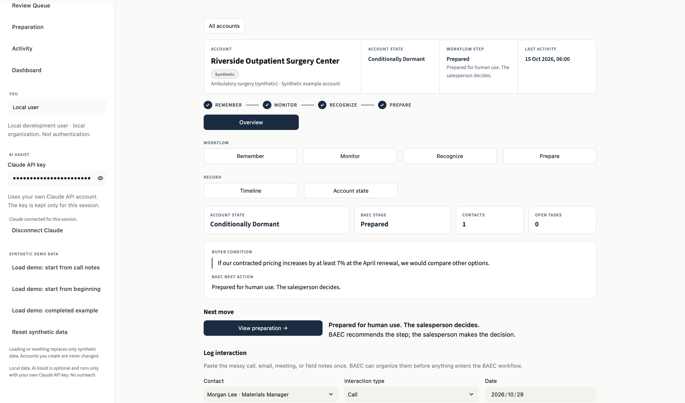
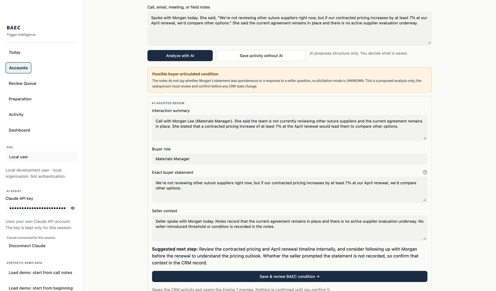
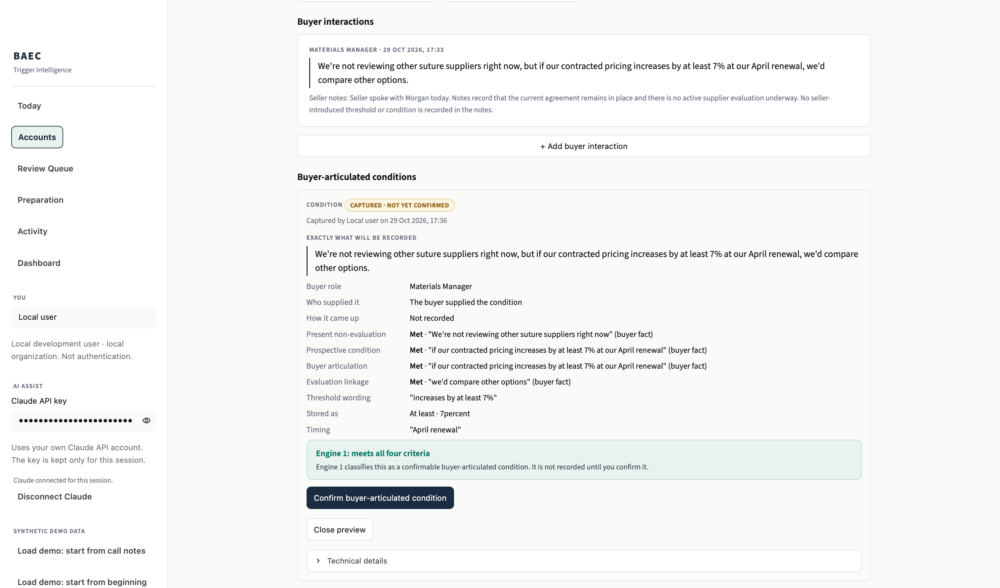
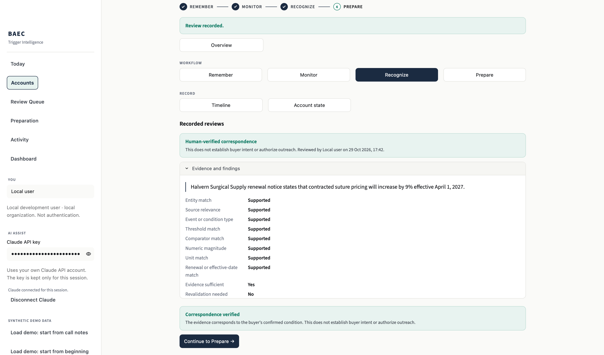
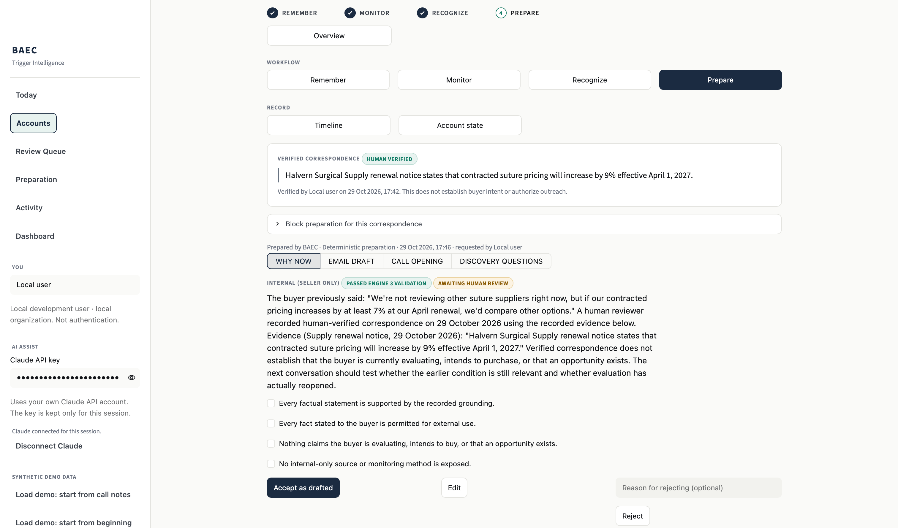
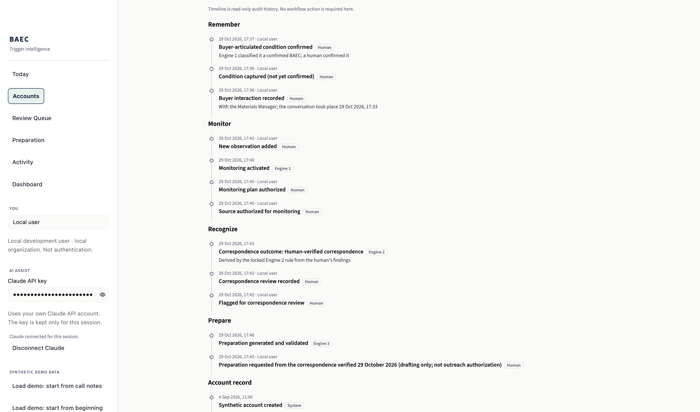
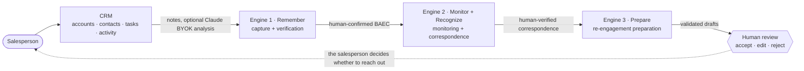
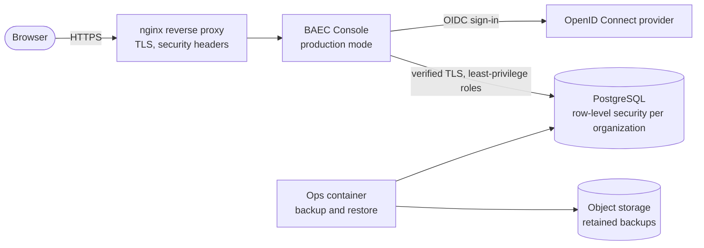

# BAEC

**An AI-assisted sales operating system built around buyer conditions, evidence, and human-controlled action.**

**Remember → Monitor → Recognize → Prepare**

BAEC remembers what a buyer said would make them reconsider. It watches for evidence that the condition has
happened, asks a person to verify whether the evidence really corresponds, and then prepares a careful next
conversation. The salesperson makes every decision that matters.

```bash
git clone https://github.com/bodhikaiparks/baec.git
cd baec
./scripts/start_demo.sh        # then open http://localhost:8501
```

The demo runs locally on synthetic data with no AWS account or database server required. An Anthropic API key is optional and only needed for Claude-assisted interaction intake.

---

## What BAEC does

Sales CRMs record activity. They usually do not remember *conditional* buyer statements, and they do not connect
those statements to evidence that turns up months later:

> “We're not evaluating other suppliers today. If our contracted pricing increases by at least 7% at the April
> renewal, we would compare other options.”

Most systems log that as an ordinary call note. BAEC treats it as a possible **Buyer-Articulated Evaluation
Contingency (BAEC)**: an explicit statement, made by a buyer who is not evaluating alternatives today, of a future
condition the buyer expects would make evaluation worthwhile.

BAEC is designed to:

- **remember** meaningful buyer conditions exactly as the buyer stated them, including thresholds and timing;
- **monitor** authorized sources for relevant changes;
- **recognize** when new evidence may correspond to the remembered condition, and ask a human to verify it;
- **prepare** an appropriate next move (an internal Why Now summary, an email draft, a call opening, and discovery
  questions) for human review;
- keep confirmation and outreach decisions with the salesperson.

A confirmed condition is not purchase intent. Verified correspondence is not an opportunity. Prepared drafts are
not permission to contact anyone.

## Workflow

```
Account → What happened? → What matters? → What changed?      → What should I prepare?
          (CRM intake)     Remember        Monitor · Recognize    Prepare
                           Engine 1        Engine 2               Engine 3
```

| Stage | Engine | What the person does | What decides |
|---|---|---|---|
| **Remember** | Engine 1: Capture + Verification | Records the interaction, reviews the four BAEC criteria, previews, confirms | Deterministic classifier and a human confirmation gate |
| **Monitor** | Engine 2: Monitoring | Authorizes a monitoring plan and its sources, records observations | Activation rule tied to the confirmed condition |
| **Recognize** | Engine 2: Correspondence | Answers each required correspondence check and the evidence-sufficiency question | Outcome derived deterministically from the human findings |
| **Prepare** | Engine 3: Re-engagement Preparation | Requests preparation with disclosure choices, then accepts, edits, or rejects each draft | Eligibility rules and the Engine 3 validator |

Around the engines sits a working CRM: accounts, contacts, tasks, activity, a **Today** page, a **Review Queue**,
**Preparation**, **Activity**, and a per-account overview and timeline.

## AI and human control

**AI can:**

- structure raw call, email, and meeting notes;
- extract a possible buyer condition, with exact-quote evidence for each criterion;
- summarize an interaction and suggest a next step;
- prepare drafts (see the note below on how this release prepares them).

**AI cannot:**

- confirm buyer intent;
- confirm a BAEC condition;
- verify correspondence;
- send outreach;
- schedule meetings;
- create an opportunity autonomously, or change account state.

Humans retain those decisions. The application validates AI output before showing it: if a proposed buyer statement
or evidence excerpt is not verbatim in the notes, the proposal is refused and nothing is applied. A possible
condition becomes an Engine 1 draft only when the person chooses to save it. It stays unconfirmed until the person
previews and confirms it.

**How drafts are prepared in this release:** the Console uses a fixed, deterministic template, and the Engine 3
validator checks every draft. Engine 3's AI-proposal contract and its offline evaluation exist as tested research
code (`docs/engine3/`, `baec_app/engine3/`), but they are not connected to the Console.

**AI features require your own Anthropic API key. The key is used only for the current session and is not stored
by BAEC.** There is no shared or server-funded key, no environment-variable fallback in the Console, and no other
AI provider.

## Features

- **CRM**: accounts, contacts, tasks, activity, account overview
- **Claude-assisted interaction intake** (bring your own key)
- **Engine 1**: exact buyer evidence, four-criterion review, deterministic classification, human confirmation
- **Engine 2**: authorized monitoring, observation provenance, corrections and supersession, exact measurements,
  human correspondence review
- **Engine 3**: eligibility, disclosure choices, grounded drafts, validation, and human review of every draft
- **Today / Review Queue / Preparation / Activity** pages
- **Durable audit history**: who did what and when. Corrections are kept, not overwritten
- **Multi-user, multi-organization architecture**: each organization owns its records, and every operation
  re-checks the principal
- **PostgreSQL production architecture with row-level security** (RLS)
- **OIDC authentication** for production. There is no self-signup: an operator links each sign-in to a BAEC user
- **Backup/restore and deployment hardening**: least-privilege database roles, TLS-only database connections,
  redacted logs, an allowlisted container build context, and a reverse proxy with HTTPS boundary tests

## Demo

Requirements: macOS or Linux, Python 3.12 or newer, and `curl`.

```bash
./scripts/start_demo.sh     # creates .venv, installs requirements.txt, starts on http://localhost:8501
./scripts/stop_demo.sh      # stops it (add --reset to delete the local demo data)
```

The script runs the Console in explicit development mode, on local SQLite files under `.demo/`, and listens only
on `127.0.0.1`. It never touches AWS or PostgreSQL. It also strips any Anthropic credential from the server's
environment, so the only way to turn on AI Assist is to paste your own key into the sidebar.

The synthetic scenario is **Riverside Outpatient Surgery Center**. Morgan Lee, the Materials Manager, says the team
is not evaluating alternatives today, but would compare other options if contracted pricing rises by at least 7% at
the April renewal. The sidebar offers three starting points:

| Sidebar button | Starts with | Claude key |
|---|---|---|
| Load demo: start from call notes | The account and contact only. You log the call and can analyze it with Claude | Optional |
| Load demo: start from beginning | The call already logged. You start at Engine 1 | Not used |
| Load demo: completed example | The whole workflow, through human acceptance of the drafts | Not used |

The step-by-step script is in [`docs/DEMO_WALKTHROUGH.md`](docs/DEMO_WALKTHROUGH.md). In the first two modes you
click every human gate yourself; nothing is pre-confirmed.

Manual alternative (no script):

```bash
python3 -m venv .venv && .venv/bin/pip install -r requirements.txt
cd baec_console && BAEC_DEPLOYMENT_MODE=development ../.venv/bin/python -m streamlit run app.py
```

## Screenshots

All six images come from the local synthetic demo (Riverside Outpatient Surgery Center, Morgan Lee). No real data.

**1. Account and workflow overview**



**2. Claude-assisted interaction intake**



**3. Engine 1 condition review**



**4. Engine 2 evidence verification**



**5. Engine 3 preparation**



**6. Complete BAEC timeline**



Hosted read-only demos from the earlier research release: https://baec-trigger-intelligence.streamlit.app ·
https://baec-engine1.streamlit.app · https://baec-engine2.streamlit.app · https://baec-engine3.streamlit.app
(described in [`docs/RESEARCH_OVERVIEW.md`](docs/RESEARCH_OVERVIEW.md)). They are hosted on Streamlit Community
Cloud, which puts inactive apps to sleep. When last checked, all four showed Streamlit's sleep page and needed a
visitor to wake them, so they may take a minute to start.

## Architecture

### Application flow



### Production architecture (not deployed by this repository)



Production mode fails closed. If the sign-in configuration, verified TLS to PostgreSQL, current migrations, or the
expected database roles are missing, the Console shows a configuration error and opens nothing. Infrastructure code
for a controlled AWS deployment (`infra/aws-controlled/`) is included as architecture only. It has placeholders and
no operator values, and nothing in this repository applies it.

### Repository layout

```
baec_console/        the Console: CRM, workspace UI, services, storage, auth, demo seed
  postgres/          PostgreSQL schema, migrations, row-level security, stores, provisioning
  tests/             SQLite Console tests
  tests_postgres/    PostgreSQL, RLS, auth, and backup tests (need the local test database)
baec_app/            the engines and domain
  domain/            BAEC criteria, classification, account-state machine (Engine 1 core)
  application/       human-authorization boundary, proposals, approvals
  engine2/           monitoring and correspondence
  engine3/           re-engagement preparation and its validator
  ai/                provider-neutral AI contracts and the Anthropic adapter used by research harnesses
  mcp/               read-only MCP server over the prototype
deploy/              container images, compose file, nginx, backup tooling, deployment tests
infra/               PostgreSQL test database (Docker) and controlled-AWS Terraform (architecture only)
experiments/         Engine 3 Stage F research harness
docs/                research contract, engine contracts, phase reports, runbook, release notes
scripts/             demo start/stop, release verifiers, test-database helper
tests/               engine, domain, AI-boundary, and research-harness tests
```

## Testing

Results on this release's export (macOS, Python 3.14; the repository and Console suites also pass on Debian Linux with
Python 3.12 and 3.14). These are software tests on synthetic data. They are not
evidence for the BAEC theory or for any sales outcome.

| Suite | Command | Result |
|---|---|---|
| Engines, domain, AI boundaries, research harness | `pytest` | 7,606 passed, 2 skipped (need the earlier history), 2 live tests deselected |
| SQLite Console | `pytest baec_console/tests` | 590 passed |
| PostgreSQL, RLS, auth, backup/restore | `pytest baec_console/tests_postgres` | 1,049 passed (546 Engine 1 parity and storage, 115 Engine 2 parity) |
| Deployment configuration and HTTPS boundary | `pytest deploy/tests` | 72 passed |

What the suites cover:

- **Engine 1** has SQLite/PostgreSQL parity tests, and its full suites also run on PostgreSQL.
- **Engine 2** has SQLite/PostgreSQL parity tests.
- **Tenant isolation** is tested on both backends, including row-level security on PostgreSQL.
- **Authentication** is tested: the OIDC flow, sign-in linking, revocation, and refusal of forged identities.
- **Backup/restore** is tested, including refusal of damaged restores.
- **Deployment boundaries** are tested: the secret boundary, the container build context, nginx, and HTTPS cookies.

```bash
python3 -m venv .venv
.venv/bin/pip install -r requirements.txt -r requirements-dev.txt
.venv/bin/python -m pytest                     # repository tests
.venv/bin/python -m pytest baec_console/tests  # Console tests
```

The PostgreSQL and deployment suites need Docker and `requirements-postgres.txt`; start the local test database with
`scripts/postgres_test_db.sh` (details in [`docs/V04_PHASE3_POSTGRES_RLS_REPORT.md`](docs/V04_PHASE3_POSTGRES_RLS_REPORT.md)).
Live Claude evaluations are opt-in and deselected by default.

## Security

- **Bring your own key.** Your Claude API key is kept only in your browser session's state. It is not written to
  disk, a database, or logs. Disconnecting or signing out clears it.
- **No autonomous sending.** There is no send, schedule, mailbox, or external CRM action anywhere in the code.
- **Human confirmation gates.** Engine 1 confirmation, account-state changes, correspondence verification, and
  draft acceptance are human actions. Each one is bound to exactly what the person was shown.
- **Row-level security.** In production, PostgreSQL enforces organization isolation beneath the application's own
  checks.
- **Production fails closed.** Missing or invalid configuration shows an error and opens nothing.

See [SECURITY.md](SECURITY.md) to report a vulnerability, and [docs/PUBLIC_RELEASE.md](docs/PUBLIC_RELEASE.md) for
what this public release does and does not include.

## Research basis

BAEC operationalizes constructs from the unpublished conceptual working paper *When the Buyer Is Not In-Market:
Buyer-Articulated Evaluation Contingencies in B2B Sales Encounters*. The working paper is intentionally not included
in this repository. The theory rules the software obeys are in [`docs/RESEARCH_CONTRACT.md`](docs/RESEARCH_CONTRACT.md).
Software behavior on synthetic data is not empirical validation of the theory.

## License

BAEC is source-available under the Business Source License 1.1. You may inspect, modify, and use BAEC for
non-production evaluation and development under the license terms. Production use requires separate authorization
until the applicable Change Date.

The source is publicly available on GitHub, but BAEC is not an open-source project. See [`LICENSE`](LICENSE): the
Licensor is Bodhi Parks, there is no Additional Use Grant, the Change Date is 2030-10-28, and the Change License is
GPL-2.0-or-later. Third-party dependencies keep their own licenses.

## Production BAEC

**Want to integrate BAEC into your sales workflow?**

The public repository is designed for local and synthetic evaluation. Production BAEC is deployed separately with
authenticated access, PostgreSQL tenant isolation, and controlled onboarding.

**[Reach out on LinkedIn](https://www.linkedin.com/in/bodhiparks) to discuss a pilot or integration.**

---

Author: Bodhi Parks · [Contributing](CONTRIBUTING.md) · [Security](SECURITY.md) · [License](LICENSE) (BSL 1.1)
