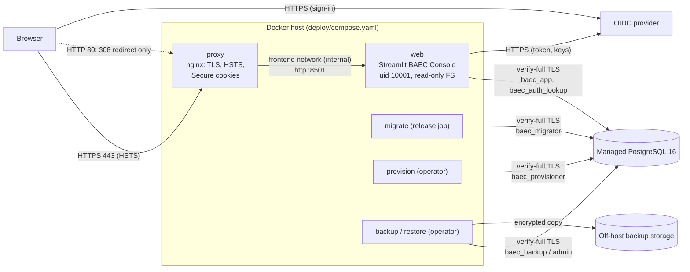

# BAEC Production Runbook (V0.4 Phase 5)

How to deploy and operate BAEC Console with the configuration in `deploy/`. Every command uses placeholders
(`<...>`); never paste a real secret into a command line, a document, a ticket, or a commit.

Status: **implemented and tested locally** (`deploy/tests`, `baec_console/tests_postgres`). **Not yet performed
against a real host, a real managed PostgreSQL, or a real identity provider.** The first controlled deployment must
follow this runbook step by step and record what differed. See
`docs/V04_PHASE5_DEPLOYMENT_HARDENING_REPORT.md` for the reasons behind each rule.

---

## 1. What runs where



| Component | Runs as | Lifetime | Network | Credentials it may hold |
|---|---|---|---|---|
| `proxy` | nginx (official image, pinned) | always | `edge` (ports 80, 443), `frontend` | TLS certificate + key |
| `web` | `baec-web` image, uid 10001 | always | `frontend` (internal), `egress` | app DB URL, sign-in lookup DB URL, Streamlit `[auth]`, DB CA |
| `migrate` | `baec-web` image | once per release | `egress` | migration DB URL, DB CA |
| `provision` | `baec-web` image | per administrator command | `egress` | provisioning DB URL, DB CA |
| `backup` | `baec-ops` image (pg 16 client) | scheduled | `egress` | backup DB URL, DB CA |
| `restore` | `baec-ops` image | recovery only | `egress` | restore (administrator) DB URL, DB CA |
| PostgreSQL 16 | managed service (recommended) | always | private, TLS required | — |
| OIDC provider | external | — | — | holds the client registration |

All BAEC roles live in **one** PostgreSQL server and database. Separate roles, not separate servers, give the
separation; the database itself is private (no public endpoint unless the platform requires one, then restricted to
the host's address).

## 2. Environment and secret contract

Names only. Secret values live in files under `BAEC_SECRETS_DIR` (outside the repository; `deploy/secrets/` is
gitignored), one value per file, never in an environment variable, an image, or a compose file.

### 2.1 Host settings (non-secret; `deploy/.env` or the shell)

| Variable | Example | Purpose |
|---|---|---|
| `BAEC_RELEASE` | `2026-11-01.1` | image tag for `baec-web`, `baec-proxy`, `baec-ops` |
| `BAEC_PUBLIC_HOST` | `baec.example.com` | public host name (no port) |
| `BAEC_PUBLIC_ORIGIN` | `baec.example.com` | `host[:port]` used in the HTTPS redirect |
| `BAEC_AUTH_ISSUER` | `https://login.example.com/<tenant>/v2.0` | the provider's exact `iss` |
| `BAEC_HSTS_MAX_AGE` | `86400` | HSTS max-age (see §8) |
| `BAEC_TLS_DIR` | `/etc/baec/tls` | `fullchain.pem`, `privkey.pem` for the proxy |
| `BAEC_SECRETS_DIR` | `/etc/baec/secrets` | the secret files below |
| `BAEC_BACKUP_STAGING_DIR` | `/var/lib/baec/backup-staging` | where a dump is written before it is copied off-host |
| `BAEC_DB_POOL_MAX_SIZE` | `4` (1–32) | app connections per web process |
| `BAEC_AUTH_DB_POOL_MAX_SIZE` | `2` (1–8) | sign-in lookup connections per web process |

Optional web settings (defaults in brackets; refused outside the range): `BAEC_DB_POOL_TIMEOUT_SECONDS` [10; 1–60],
`BAEC_DB_STATEMENT_TIMEOUT_MS` [30000; 1000–300000], `BAEC_DB_LOCK_TIMEOUT_MS` [5000; 100–60000, below the statement
timeout], `BAEC_DB_IDLE_IN_TRANSACTION_TIMEOUT_MS` [60000; 1000–600000], `BAEC_AI_MODEL`.

### 2.2 Secret inventory and who may receive each

| Secret file (in `BAEC_SECRETS_DIR`) | Content | Received by | Never by |
|---|---|---|---|
| `baec_app_database_url` | `postgresql://baec_app:<pw>@<db-host>:5432/<db>?sslmode=verify-full&sslrootcert=/run/secrets/baec_postgres_ca.crt` | web (+ its readiness check) | anything else |
| `baec_auth_database_url` | same form, role `baec_auth_lookup` | web | anything else |
| `baec_streamlit_auth.toml` | `[auth]` `client_id`, `client_secret`, `cookie_secret`, `redirect_uri`, `server_metadata_url` | web | anything else |
| `baec_postgres_ca.crt` | the database server's CA certificate (public, but pinned) | every DB client | — |
| `baec_migration_database_url` | role `baec_migrator` | migrate | web, provision, backup |
| `baec_provisioning_database_url` | role `baec_provisioner` | provision | web, migrate, backup |
| `baec_backup_database_url` | role `baec_backup` | backup | web, migrate, provision |
| `baec_restore_database_url` | the platform administrator, target database | restore (only during recovery) | everything else; delete the file after use |
| TLS key (`BAEC_TLS_DIR/privkey.pem`) | proxy certificate key | proxy | every BAEC container |
| backup-storage credential | write-only upload credential | the off-host copy step (§12) | every BAEC container |
| platform/deploy credentials (registry, cloud) | — | the operator's deploy session | every container |

**Not a server secret:** the Claude API key. Each person enters their own in the browser; it lives in that session
only and is cleared on sign-out. There is no environment fallback, and the web process **refuses to start** if any
`ANTHROPIC_*` variable is set (`baec_console/deployment.py`).

The web process also **refuses to start** if `BAEC_MIGRATION_DATABASE_URL`, `BAEC_PROVISIONING_DATABASE_URL`,
`BAEC_BACKUP_DATABASE_URL`, `BAEC_RESTORE_DATABASE_URL`, or any of them with `_FILE`, is present.

File permissions: each secret file is readable only by the container user that reads it — uid **10001** for
web/migrate/provision, uid **70** for backup/restore (e.g. `chown 10001 <file> && chmod 0400 <file>`); the directory
is `0700`, owned by root.

## 3. Initial setup

1. **Host.** A Linux VM with Docker Engine and the Compose plugin; inbound 80 and 443 only; SSH restricted.
   No other service listens on 80/443.
2. **DNS** (do this yourself; nothing here changes DNS): an `A`/`AAAA` record `BAEC_PUBLIC_HOST` → the host.
   No wildcard records for BAEC.
3. **TLS certificate** for `BAEC_PUBLIC_HOST` from a public CA (ACME or the platform's), installed as
   `BAEC_TLS_DIR/fullchain.pem` and `privkey.pem` (`0400`, root). Renew before expiry and `docker compose restart proxy`.
4. **PostgreSQL 16**, managed, with: TLS required for every connection (e.g. a `force_ssl`/`require_secure_transport`
   setting; plaintext `host` entries rejected), no public endpoint (or restricted to the host's address), automated
   snapshots/point-in-time recovery enabled, and the server CA certificate downloaded to
   `BAEC_SECRETS_DIR/baec_postgres_ca.crt` (or `sslrootcert=system` if the server certificate chains to a public CA).
5. **Roles and database** (§4), **images** (§5), **secrets** (§2), **migrations** (§6), **OIDC** (§9), **start** (§10).

## 4. Database roles (DBA bootstrap)

Run once, as the platform administrator, over TLS. Generate each password with a password manager or
`openssl rand -base64 32`; type it at the `\password` prompt, never on a command line.

```sql
CREATE ROLE baec_migrator    LOGIN CONNECTION LIMIT 4  NOSUPERUSER NOCREATEDB NOCREATEROLE NOREPLICATION NOBYPASSRLS NOINHERIT;
CREATE ROLE baec_app         LOGIN CONNECTION LIMIT 12 NOSUPERUSER NOCREATEDB NOCREATEROLE NOREPLICATION NOBYPASSRLS NOINHERIT;
CREATE ROLE baec_auth_lookup LOGIN CONNECTION LIMIT 8  NOSUPERUSER NOCREATEDB NOCREATEROLE NOREPLICATION NOBYPASSRLS NOINHERIT;
CREATE ROLE baec_provisioner LOGIN CONNECTION LIMIT 2  NOSUPERUSER NOCREATEDB NOCREATEROLE NOREPLICATION NOBYPASSRLS NOINHERIT;
CREATE ROLE baec_backup      LOGIN CONNECTION LIMIT 2  NOSUPERUSER NOCREATEDB NOCREATEROLE NOREPLICATION BYPASSRLS INHERIT;
GRANT pg_read_all_data TO baec_backup;
\password baec_migrator
\password baec_app
\password baec_auth_lookup
\password baec_provisioner
\password baec_backup

CREATE DATABASE <db>;
REVOKE ALL ON DATABASE <db> FROM PUBLIC;
GRANT CONNECT, CREATE ON DATABASE <db> TO baec_migrator;
GRANT CONNECT ON DATABASE <db> TO baec_app, baec_auth_lookup, baec_provisioner, baec_backup;
\c <db>
REVOKE ALL ON SCHEMA public FROM PUBLIC;
```

**Connection limits.** `baec_app` ≥ (web replicas × `BAEC_DB_POOL_MAX_SIZE`) + 2 per replica for the readiness check;
`baec_auth_lookup` ≥ replicas × (`BAEC_AUTH_DB_POOL_MAX_SIZE` + 2). The web service refuses to start if a role has no
limit or a limit below its pool size. Keep the sum below the server's `max_connections` minus the platform's reserve.

**What each role can do** (as verified on the test cluster after migrations 0001–0005):

| Role | Attributes | Privileges |
|---|---|---|
| `baec_migrator` | no superuser, no BYPASSRLS, NOINHERIT | owns every BAEC schema object; RLS is FORCEd, so even it sees tenant rows only with a tenant setting |
| `baec_app` | none; member of no role; owns nothing | SELECT, INSERT on the 20 product, 25 Engine 1, and Engine 2 tables; UPDATE only of `users.active, display_name`, `crm_tasks.status, completed_at, completed_by`, `crm_activities.engine1_interaction_id`, `engine1.accounts.state`; SELECT on `schema_migrations`; **nothing** in `baec_auth`; no DELETE, TRUNCATE, REFERENCES, TRIGGER, CREATE; cannot SET ROLE, set `session_replication_role`, or turn row security off |
| `baec_auth_lookup` | none; no memberships | USAGE on `baec_auth`; SELECT of five columns of `auth_identities` (`issuer, subject, organization_id, user_id, revoked_at`), one exact row per transaction (RLS); no other schema |
| `baec_provisioner` | none | inside one organization's tenant transaction: SELECT/INSERT `organizations`, `users`, `identity_audit`, `auth_identities`; UPDATE `users.active`, `auth_identities.revoked_at, revoked_by`; no CRM, account, or engine data |
| `baec_backup` | BYPASSRLS, member of `pg_read_all_data` | reads every row (so a dump is complete); writes nothing |

The web service's startup gate verifies the app and lookup roles exactly and refuses anything wider (§10). If the
platform cannot create a BYPASSRLS role, use the platform's snapshots/PITR as the backup and run logical dumps
(§12) as the platform administrator instead.

## 5. Build the images

```sh
cd <repository>
docker build -f deploy/Dockerfile -t baec-web:<release> .
docker build -t baec-proxy:<release> deploy/nginx
docker build -t baec-ops:<release> deploy/ops
```

The web image installs only `deploy/requirements.lock` (exact versions, SHA-256 of every file, `--no-deps`, then
`pip check`), runs as uid 10001, and contains no secret, test, local data, MCP server, or git history. To upgrade a
dependency: change `deploy/requirements.in`, run every suite, then `python deploy/lock_requirements.py` (network
access to PyPI) and `python deploy/lock_requirements.py --check` in review.

## 6. Migrations (the release job)

Migrations are ordered, checksummed, forward-only, and applied in **one** transaction per run: either every pending
migration commits or none does. Only the release job holds the migration credential.

```sh
cd <repository>/deploy
docker compose --profile release run --rm migrate
# applied migrations: [...]; schema verified     or     schema is current; nothing applied
```

A changed or unknown recorded migration stops the run ("has changed since it was applied"). Never edit an applied
migration; never run migrations from the web service.

## 7. Provisioning users (CLI only)

There is no sign-up and no admin screen. An administrator:

1. creates the organization and a HUMAN user:
   ```sh
   docker compose --profile ops run --rm provision create-organization --organization <org-id> --name "<name>"
   docker compose --profile ops run --rm provision create-user --organization <org-id> --user <user-id> --name "<name>"
   ```
2. obtains the person's provider **subject** (`sub`) out of band — from the provider's admin console or a one-time
   sign-in by that person (BAEC refuses them with "does not give access" until linked). Confirm it is the stable,
   non-reassignable identifier (§9), not an email or display name.
3. links it:
   ```sh
   docker compose --profile ops run --rm provision link --organization <org-id> --user <user-id> \
     --issuer <BAEC_AUTH_ISSUER> --subject <sub> --operator "<administrator name>"
   ```
4. the person signs in at `https://<BAEC_PUBLIC_HOST>`. (Tested end to end through the deployed stack:
   `deploy/tests/test_https_boundary.py`.)

The organization is never inferred from email domain, provider tenant, display name, or any claim; only the
`(issuer, subject)` link decides.

## 8. HTTPS, TLS, and HSTS

* nginx terminates TLS 1.2/1.3; HTTP answers only `308` to `https://<BAEC_PUBLIC_ORIGIN><path>` (query dropped);
  unknown host names get no answer; an unknown TLS name is refused.
* Every cookie the application sets is given `Secure` at the proxy (Streamlit's own sign-in cookie lacks it).
* `X-Forwarded-For` is the peer address and `X-Forwarded-Proto` is always `https`; client-sent forwarding headers are
  not trusted. The web service is reachable only from the proxy (internal network, no published port).
* **HSTS:** start with `BAEC_HSTS_MAX_AGE=86400` (one day). After two weeks with every BAEC URL working over HTTPS,
  raise it to `31536000`. Add `includeSubDomains` only after confirming every subdomain of the registered domain is
  HTTPS-only (it applies to all of them). **Do not preload**: preload lists ship in browsers and removal takes months;
  it needs an explicit decision by the domain owner.

## 9. OpenID Connect provider checklist

Before the first sign-in, record (non-secret metadata only) and verify:

| Item | Requirement |
|---|---|
| Issuer | `BAEC_AUTH_ISSUER` equals the provider's `iss` **exactly** (scheme, host, path, trailing slash). Read it from `<issuer>/.well-known/openid-configuration`. |
| Discovery URL | `server_metadata_url` = issuer + `/.well-known/openid-configuration` (the web service refuses anything else). |
| Client | a confidential web client; `client_id` and `client_secret` in `baec_streamlit_auth.toml` only. |
| Redirect URI | exactly `https://<BAEC_PUBLIC_HOST>/oauth2callback`; no wildcards, no http, no other hosts. |
| Post-logout redirect | register the same URI if the provider supports RP-initiated logout (Streamlit sends it). |
| Scopes | `openid` (plus `email` if wanted for display; email is never used for authorization). |
| Subject | stable and never reassigned. Choose public or pairwise once and never change it: changing it unlinks everyone. |
| Cookie secret | `cookie_secret` ≥ 32 random characters, unique to this deployment. |
| Tokens | `expose_tokens` must not be set (the web service refuses it). |
| Logout | `st.logout` clears the BAEC cookie in that browser and, if offered, starts the provider's logout. It is not a server-side session kill (§14). |

A live provider has **not** been exercised in this phase. When it is, record only the issuer, the client type, the
redirect URI, the scopes, the subject type, and the outcome.

## 10. Start, readiness, and liveness

```sh
cd <repository>/deploy
docker compose --profile release run --rm migrate   # each release, first
docker compose up -d --wait                          # proxy waits for web to be healthy
docker compose exec web python -m baec_console.readiness            # prints: ready
docker compose exec web python -m baec_console.readiness --explain  # operators: why not ready (names only)
```

* **Liveness:** `GET /_stcore/health` → `ok` (no sign-in, no database).
* **Readiness:** `python -m baec_console.readiness` runs the full production startup: secret boundary, connection
  bounds, verified TLS on both connections, migrations and checksums, role attributes and privileges, RLS, Engine 1,
  Engine 2, product and sign-in schemas, the lookup role, the OIDC configuration, connection limits, and that pooled
  sessions carry the timeouts. It writes nothing and prints one code: `ready`, or `not ready: MODE | SECRET_BOUNDARY |
  SIGN_IN_CONFIGURATION | DATABASE | DATABASE_SCHEMA | DATABASE_UNAVAILABLE | CONFIGURATION | INTERNAL`.
* The compose health check is readiness **and** liveness, every 60 s. **Compose does not restart an unhealthy
  container by itself:** monitor `docker compose ps` (or the platform's health status) and act (§16).

## 11. Revoking access and deactivating users

Both take effect on the person's **next request**, in every open session, without a restart.

```sh
# Permanent: this sign-in can never be used again (a new subject must be linked to restore access)
docker compose --profile ops run --rm provision revoke --organization <org-id> --issuer <issuer> --subject <sub> --operator "<name>"
# Reversible: the user is refused until reactivated
docker compose --profile ops run --rm provision deactivate --organization <org-id> --user <user-id>
docker compose --profile ops run --rm provision reactivate --organization <org-id> --user <user-id>
```

## 12. Backups

| | |
|---|---|
| Primary mechanism | the managed platform's automated snapshots + point-in-time recovery (WAL), retention ≥ 7 days |
| Secondary (tested here) | logical dump: `docker compose --profile ops run --rm backup` → `baec-<UTC>.dump` + `.sha256` in `BAEC_BACKUP_STAGING_DIR` |
| Frequency | PITR continuous; logical dump daily and before every release |
| Retention | logical dumps: 30 daily + 12 monthly (adjust to policy) |
| Encryption | at rest in the off-host store (provider-managed KMS key) **and** in transit (TLS). The staging copy is plaintext on the host for minutes only. |
| Storage | off this host: an object store bucket with versioning and object lock/immutability, in another account or project; upload with a write-only credential; delete the staging copy after a verified upload |
| Access | backup job: `baec_backup` only. Restoring: the platform administrator, during an incident only. Dumps contain every organization's records: treat them as production data. |
| RPO | PITR: minutes. Logical dump only: up to 24 h (or since the pre-release dump). |
| RTO | target 4 h for the first controlled deployment (restore into a new database, verify, switch); **not measured on production-size data** — the local drill took seconds on synthetic data. |

Copy off-host after each dump, for example (placeholders; use your store's CLI):

```sh
sha256sum -c <BAEC_BACKUP_STAGING_DIR>/baec-<stamp>.dump.sha256
<object-store-cli> cp <BAEC_BACKUP_STAGING_DIR>/baec-<stamp>.dump* <bucket>/baec/ --sse kms
rm <BAEC_BACKUP_STAGING_DIR>/baec-<stamp>.dump*
```

Never treat a backup as working until a restore from it has passed §13 at least once per quarter.

## 13. Restore

Restore into a **new, empty** database, verify it, then switch the web service to it. Never restore over the live
database.

```sh
# 1. DBA: CREATE DATABASE <new-db> and the grants of §4 (roles already exist in the cluster)
# 2. fetch the dump and its .sha256 into BAEC_BACKUP_STAGING_DIR; write the administrator URL for <new-db> to
#    BAEC_SECRETS_DIR/baec_restore_database_url (0400)
docker compose --profile restore run --rm restore /backups/baec-<stamp>.dump
rm <BAEC_SECRETS_DIR>/baec_restore_database_url
# 3. point baec_app_database_url and baec_auth_database_url at <new-db>, then verify before serving:
docker compose --profile release run --rm migrate          # applies nothing if the dump is from this release
docker compose up -d --force-recreate web && docker compose exec web python -m baec_console.readiness
```

The tool refuses a file whose checksum differs and a target that already has BAEC schemas; `pg_restore` runs in one
transaction, so a failed restore leaves the target empty. A partial, altered, or older restore is refused by
readiness (`DATABASE` / `DATABASE_SCHEMA`) and BAEC does not serve it. Logical restore needs a superuser-equivalent
role (it disables triggers while loading rows); where the platform does not offer one, use its PITR/snapshot restore
into a new instance instead, then run readiness.

## 14. Sessions

| | |
|---|---|
| BAEC session lifetime | **12 hours** from the ID token's `iat`, checked at sign-in and on every operation (unchanged) |
| Streamlit cookie lifetime | 30 days (Streamlit's; BAEC refuses it after 12 h) |
| Revocation / deactivation | immediate: next request, every session (§11) |
| Browser sign-out | clears that browser's session state (console, Claude key) and cookie |
| A copied cookie | usable from another browser until 12 h after sign-in, unless the link is revoked or the user deactivated |
| Global logout | **there is no per-session server-side logout.** Rotating `cookie_secret` (§15) invalidates every BAEC session at once |

## 15. Credential rotation

* **Database password** (any role): `ALTER ROLE <role> PASSWORD` via `\password <role>`; update the one secret file;
  for `baec_app`/`baec_auth_lookup`: `docker compose up -d --force-recreate web` (a brief interruption). Old
  connections keep working until they are recycled (≤ 30 min) or the service restarts.
* **OIDC client secret:** create the new secret at the provider, update `baec_streamlit_auth.toml`, recreate web,
  then delete the old secret at the provider.
* **Cookie secret:** replace `cookie_secret`, recreate web. **Every** user is signed out (incident lever).
* **TLS certificate:** replace the files, `docker compose restart proxy`.
* **Backup-storage credential:** rotate in the store; update the uploader only.

## 16. Incident shutdown

In order of reach (each is reversible):

1. one person: `provision revoke` (permanent) or `provision deactivate` (§11);
2. every session: rotate `cookie_secret` (§15);
3. stop serving: `docker compose stop proxy` (nothing reachable) or `docker compose stop web` (proxy answers 502);
4. cut the database: `ALTER ROLE baec_app NOLOGIN; ALTER ROLE baec_auth_lookup NOLOGIN;` then terminate their
   sessions (`SELECT pg_terminate_backend(pid) FROM pg_stat_activity WHERE usename IN ('baec_app','baec_auth_lookup')`).
   BAEC fails closed: every page shows a refusal.

Unhealthy web (readiness failing): `docker compose exec web python -m baec_console.readiness --explain`, fix the cause,
then `docker compose restart web`. A restarted web service re-runs every startup check before serving.

## 17. Upgrade

1. Read the release notes; build `baec-web`, `baec-proxy`, `baec-ops` for `<release>`.
2. Take a logical backup (§12) and note the PITR timestamp.
3. `BAEC_RELEASE=<release> docker compose --profile release run --rm migrate`.
4. `BAEC_RELEASE=<release> docker compose up -d --wait`; check readiness and sign in.

## 18. Rollback and recovery from a failed release

* **Migration failed:** nothing was applied (one transaction). Keep or restart the previous release's web service;
  fix the release.
* **Migration applied, new web fails:** the previous web image **refuses** a database with a migration it does not
  know (by design). Either fix forward (preferred), or restore the pre-release backup into a new database (§13) and
  run the previous release against it. Migrations are never rolled back in place.
* **Bad configuration:** readiness names the area (`--explain`); fix the secret or setting and recreate web.
